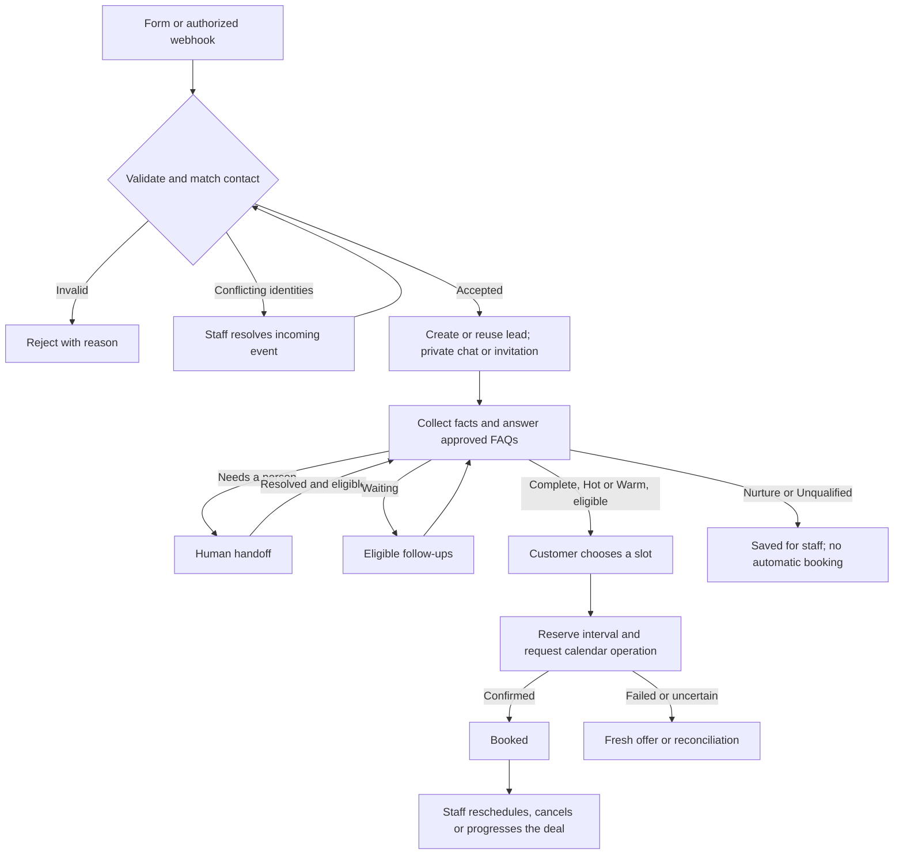

# End-to-end product flow

Customer and staff guide for the implemented standalone edition. For verification/deployment boundaries see [status](status.md); for routes and payloads see [API](api.md). This is a behavior guide, not a passing test report.

## Journey and roles

STOP or valid unsubscribe confirmation can interrupt outreach throughout the journey. Booking confirmation requires a confirmed calendar result.

| Actor             | Workflow                                                                                                                            |
| ----------------- | ----------------------------------------------------------------------------------------------------------------------------------- |
| Customer          | Enquiry, own private chat, questions, request for a person, slot selection, secure return and opt-out.                              |
| Manager           | Inbox, Leads, Activity; replies, controls, field edits, notes, stages, meetings, score recalculation and eligible recovery actions. |
| Administrator     | Manager actions plus settings, rule publication, consent restoration and demo Outbox.                                               |
| Authorized source | Authenticated webhook intake; not a public form.                                                                                    |

Staff enter through `/login`. Inbox provides history and project context; Leads provides a searchable table. **Open lead** exposes **Timeline**, **Data**, **Score** and **Meetings**. Activity contains execution and incoming-event logs. Settings and Outbox are described below. Customers use `/enquire`, `/chat` and email links.

## 1. Intake and access

1. Customer opens `/enquire`, enters name, email/optional international phone and optionally a service, then selects **Start my conversation**.
2. Validation requires email or valid international phone. Missing name becomes “New enquiry”. The intake event is recorded.
3. A new contact receives a lead and visitor session; `/chat` asks the first unanswered question. Selecting service in the form normally skips that question.
4. An authorized webhook follows the same matching rules. An eligible new lead with email receives an invitation; a phone-only webhook without a customer session goes to staff.

Contacts are matched by normalized email, phone and source-specific external identity. Public submissions never overwrite trusted channels.

| Situation                                         | Result                                                                                               |
| ------------------------------------------------- | ---------------------------------------------------------------------------------------------------- |
| Same source/event key and same payload            | Previous result reused. Different payload with that key is rejected.                                 |
| Existing contact, one active deal per contact     | Active lead reused.                                                                                  |
| One active deal per contact and service           | Matching service reused; a different service may create another lead.                                |
| Conflicting identities or ambiguous active deals  | **needs_resolution**; staff chooses the correct contact in **Activity → Incoming events → Resolve**. |
| Existing contact from a different visitor session | No automatic access to their chat. Use an existing session, eligible recovery link or staff help.    |

Won/Lost are excluded from active-deal matching; Proposal remains active for this purpose. A typed email alone does not verify the address. A web session can start before email verification; exchanging an email access token verifies it.

## 2. Qualification and scoring

Default question order is service → location → budget → timeline → decision maker. Service/location are required. The assistant asks one question at a time but can extract several fields from one answer. Service and location questions name the covered services and areas; a repeated question says the previous answer was not understood. The customer chat shows a typing indicator while the assistant is replying.

Budget uses known minimum/maximum bounds; timeline is the conservative upper bound in months. Unknown values remain unknown. Optional questions are still asked and must be answered or skipped to complete the normal flow. After repeated unsuccessful clarification, an optional field can be skipped; an unknown required field causes handoff.

Approved FAQ questions return configured answers without spending another clarification attempt. Requests for a person, restricted topics, extraction failures or locked-field conflicts can trigger handoff. A question the FAQ cannot answer does not: the assistant says it has passed the question to the team and continues qualification, and the lead appears under **Needs attention** until a manager replies in the chat or uses **Mark question answered**. In demo mode the customer chat notes that no one monitors it while the conversation is with the team or a question is waiting. Unsupported service/location produces Unqualified without completing every remaining question; the assistant names the covered services or areas and waits for a corrected answer, which requalifies the lead.

The parser/LLM extracts facts; application code calculates and records the score:

| Default factor                       | Points                                                                                      |
| ------------------------------------ | ------------------------------------------------------------------------------------------- |
| Supported service / covered location | 25 each.                                                                                    |
| Budget                               | 25 when the lower bound meets 10,000; 10 when only the upper bound reaches it; otherwise 0. |
| Timeline                             | 15 within 3 months, 10 within 6, 5 beyond 6; unknown 0.                                     |
| Decision maker                       | 10 for a known decision maker.                                                              |

Hot starts at 80, Warm at 60; lower scores are Nurture. Unsupported service/location overrides the score with Unqualified. **Score** shows reasons and evaluation history. Existing leads keep their rule version until **Recalculate with latest rules**.

Booking additionally requires complete qualification, Hot/Warm, email, current required answers and coverage, AI ownership, no pause/opt-out/review, and no conflicting appointment. Booked/Proposal/Won/Lost cannot self-book. A suitable phone-only lead is asked for email; Nurture/Unqualified stays available to staff without automatic booking.

## 3. Booking and meeting changes

1. **Choose a consultation time** gets slots based on calendar busy intervals, local reservations, company time zone, working hours/days, duration, buffer, minimum notice and horizon.
2. Customer selects a server-issued slot. The application reserves the interval and queues the calendar operation; the worker rechecks eligibility and availability.
3. Confirmed success sets Booked, stops pending follow-ups and saves a staff summary. The appointment card displays confirmation; a chat confirmation is added when automation remains eligible.
4. A stale/occupied offer shows an explanation and automatically loads fresh availability. A known background booking failure remains visible after reload and also loads fresh times when the lead is still eligible. **Refresh available times** retries loading offers if needed; repeated requests with the same key do not create another meeting.

Pending means accepted for processing. Unknown means the external effect may already exist and requires reconciliation. Neither means confirmed. Meeting times use the appointment's time zone.

| Staff action in Meetings                      | Result                                                                                                                                                                              |
| --------------------------------------------- | ----------------------------------------------------------------------------------------------------------------------------------------------------------------------------------- |
| **Reschedule** → select fresh slot            | Old booking stays active until the change is confirmed. Coverage, qualification and offer freshness are checked. Staff may handle an existing meeting while ownership is HUMAN.     |
| **Cancel appointment → Keep appointment**     | Dismisses without cancellation.                                                                                                                                                     |
| **Cancel appointment → Confirm cancellation** | Queues cancellation; old appointment remains confirmed until acknowledgement. Then reservations release and the stage becomes Qualified for complete Hot/Warm, otherwise Contacted. |

Cancellation suppresses follow-ups; old sequences do not restart. A new explicit booking may still be possible when eligible. Changing a deal stage or stopping automation does not cancel a calendar event.

## 4. Staff controls and deal progress

Find a lead through search (name/email/phone/service) or **All**, **Needs attention**, **AI active**, **Human**, **Booked**. Search/filtering covers the dataset; dashboard counters remain global. Open the profile for field provenance, proposed changes, score, audit trail and meetings.

In Inbox Details and the profile's Data tab, select a field value marked **View source** to expand its original lead message and timestamp. Budget minimum and maximum show their sources separately. Manual edits are labelled as team edits; fields without a recorded message do not invent a source.

| Action                         | Effect and boundary                                                                                                                                                           |
| ------------------------------ | ----------------------------------------------------------------------------------------------------------------------------------------------------------------------------- |
| **Take over**                  | HUMAN ownership assigned to acting staff; pending automation cancelled.                                                                                                       |
| **Send reply**                 | Personal message appears in customer chat and takes HUMAN ownership. Blocked for opted-out contacts; not a separate email/SMS delivery.                                       |
| **Edit fields**                | Changed fields lock against AI overwrites by default. Conflicts become proposals and trigger review. **Unlock …** permits future changes; it does not accept a past proposal. |
| **Add note**                   | Private team note, absent from customer chat.                                                                                                                                 |
| **Return to AI**               | AI ownership. Existing review requires resolution notes. Does not clear pause, opt-out or a closed stage.                                                                     |
| **Pause / Resume**             | Set/clear pause independently of ownership. Messages can still be saved; Resume processes them only when automation is eligible.                                              |
| **Restore consent separately** | Admin reason plus explicit renewed-consent confirmation. Does not automatically return AI ownership or restart old follow-ups.                                                |

To resolve a handoff: read the reason, summary and messages; correct/unlock relevant fields; select **Return to AI**, record resolution notes and submit **Resolve and return to AI**. Obsolete assistant drafts are discarded if state changes during generation.

Stages are New, Contacted, Qualified, Booked, Proposal, Won and Lost, not a mandatory linear wizard. First contact normally sets Contacted; suitable completion sets Qualified, and lost eligibility can revert it. Booked requires a confirmed meeting; Lost requires a reason. Proposal/Won/Lost block automation. Stage, score/category, ownership, pause, review and contact consent are separate states.

Manager assignment has a protected API but no dedicated picker in the current browser UI. Take over records the acting staff member.

## 5. Follow-ups, return links and consent

| Sequence                  | Waiting period begins                                   | Default delays from that start |
| ------------------------- | ------------------------------------------------------- | ------------------------------ |
| Unfinished qualification  | Assistant/invitation awaits qualification response.     | 1 hour, 1 day, 3 days.         |
| Qualified, not yet booked | Lead becomes eligible for booking and awaits selection. | 1, 3, 7 days.                  |

Before each send, the worker checks consent, ownership, pause, review, stage, email, latest reply, waiting period and appointments. Changed conditions cancel obsolete outreach. Sends outside working hours are deferred; obsolete overdue touches can be skipped instead of sent together. There are at most three confirmed/in-flight/uncertain touches per lead and sequence type. Queued messages retain their saved template; settings changes do not rewrite them.

Emails contain separate chat and unsubscribe links:

- **Continue securely** exchanges a chat token once for a visitor session and verifies email. Page preview alone does not consume it. Chat tokens last 24 hours; visitor sessions currently last seven days.
- Without a session, `/chat` offers **Request a new link**. Recovery needs a previously verified email, no opt-out and a lead not Won/Lost. HUMAN ownership or pause alone does not block access recovery. Responses are neutral and rate-limited; entering an email is not a guarantee of delivery.
- **Unsubscribe** uses a separate scoped token (currently 90 days) and needs no staff login. Without a token, the page explains that a valid link is required and offers the chat.
- STOP or unsubscribe stops pending outreach for all leads of that contact, without cancelling appointments. An ordinary message or new intake never restores consent.
- Admin restoration requires **Restore consent separately → evidence/reason → I have verified renewed consent → Record renewed consent**. Access recovery and AI ownership are separate actions.

## 6. Configuration and operational exceptions

| Settings area          | Configure                                                                                                                                          |
| ---------------------- | -------------------------------------------------------------------------------------------------------------------------------------------------- |
| Company & availability | Name, IANA zone, currency, services/coverage, hours/days, duration, buffer, horizon, notice, deduplication and brand voice. No overnight schedule. |
| Qualification          | Question wording/order and required flags; service/location remain required.                                                                       |
| Knowledge & safety     | Approved FAQ answers, matching phrases and topics requiring a person. **Add FAQ** creates a draft; populate and save.                              |
| Scoring rules          | Weights summing to 100, budget threshold and Hot/Warm cutoffs. Publishing creates an immutable version with current coverage/currency.             |
| Email follow-up        | Three ascending delays per sequence and shared subject/body.                                                                                       |

Each form saves independently. Invalid values are rejected; a stale settings revision requires reload. Coverage/currency changes do not publish rules automatically: publish a version and recalculate selected existing leads when needed. Current coverage still gates booking even for an old Hot score. Keep FAQ/question wording aligned with company changes.

Provider cards report ENV configuration, not editable switches; see [integrations](integrations.md). Demo Outbox is administrator-only: it previews saved mock emails and their return/unsubscribe links.

| Activity situation                            | Action                                                                                                |
| --------------------------------------------- | ----------------------------------------------------------------------------------------------------- |
| Rejected intake / identifier conflict         | Correct source data or use **Resolve** with the correct contact.                                      |
| Known failed eligible action                  | **Retry safely** after resolving restrictions.                                                        |
| Unknown external result                       | **Reconcile** before another effect; never assume nothing happened.                                   |
| Failed booking/reschedule                     | Get a fresh offer and create a fresh operation; generic retry does not replay a stale calendar offer. |
| Cancellation uncertainty                      | Inspect/reconcile the existing event before another cancellation.                                     |
| Assistant failure / unanswered required field | Handle the conversation, then explicitly resolve review.                                              |

Queue-action and provider-operation states differ. Inspect the relevant operation, not only whether an action says done. Expired staff sessions require sign-in; session/CSRF errors may require reload. Recovery and backup procedures are in the [runbook](runbook.md).

## 7. Demo walkthrough

Use unique fictional contacts and mock providers, with customer/staff in separate browser sessions.

1. Review settings and rules. Submit a new Roofing enquiry with an `@example.test` address.
2. Send: `Roofing in Demo City A. Budget $25000. I own this home and want to start in 2 months.` Expect Hot 100/100 under defaults and booking choices.
3. Book a slot; wait for confirmation and reload. Find the lead in CRM and inspect all four profile tabs.
4. Reschedule, wait for confirmation, cancel, then wait for cancelled status.
5. Edit/lock budget; send a conflicting customer answer and inspect the proposal. Resolve review, try Pause/Resume and a manual reply.
6. Send STOP, then another ordinary message; automation must remain stopped. Test admin consent restoration separately from AI ownership.
7. As manager, confirm settings editing, Outbox and consent restoration are unavailable.
8. Inspect Activity. Cancel test appointments and mark test leads Lost with a reason; retain history as evidence.

Additional branches: opening-hours FAQ, `Outside City`, question beyond FAQ, incomplete required answer, expired link and duplicate enquiry. Mock parsing does not represent unrestricted real-model behavior. See [dated audit and coverage gaps](status.md).
